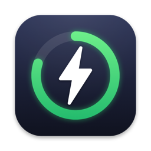

<p align="center"></p>

# Runs - GitHub Actions Menu Bar App

A native macOS menu bar app that shows the latest GitHub Actions workflow runs for the repositories you pick.


## Features

- **Menu Bar Integration** - Lives in your menu bar, out of the Dock
- **GitHub Sign-in** - Uses GitHub's Device Flow; no client secret ships in the app
- **Touch ID Protection** - Optional; the Keychain itself won't release your token without it
- **Repository Selection** - Choose which repositories to monitor, from all repos you can access
- **Auto Refresh** - Every 5 minutes, and whenever you open the menu with stale data
- **Workflow Status** - Latest run per repo with success / failure / in-progress status
- **Quick Copy** - Click a run to copy its URL (or the commit hash for successful runs)
- **Resilient** - Handles GitHub rate limits, and one failing repo doesn't hide the others

## Installation

### Download (recommended)

1. Download `Runs-<version>.dmg` from the [latest release](https://github.com/kekayan/Runs/releases/latest)
2. Open it and drag Runs into Applications (a zip is also available)
3. Open it - the app is signed with Developer ID and notarized by Apple

### Requirements

- macOS 26.2 or later
- A GitHub account
- Xcode 26 or later, only if building from source

## Usage

1. Click the menu bar icon, then the gear icon to open Settings
2. Click **Login with GitHub**
3. GitHub opens in your browser and the sign-in code is copied to your clipboard - paste it and approve
4. Back in Settings, select the repositories to monitor
5. Click the menu bar icon to see their latest runs

**Tips:**
- Click the refresh icon to update right away
- Turn on Touch ID in Settings to require it before the token is unlocked

## Security

- **No client secret.** Sign-in uses the [OAuth Device Flow](https://docs.github.com/en/apps/oauth-apps/building-oauth-apps/authorizing-oauth-apps#device-flow), so there's no secret to extract and no redirect URL another app could forge.
- **Token storage.** Your token is stored in the macOS Keychain, readable only while your Mac is unlocked and never synced to other devices.
- **Touch ID.** When enabled, the token is stored with a biometric access control, so the Keychain refuses to release it without Touch ID. Adding or removing fingerprints invalidates it, and you'll need to sign in again.
- **Scope.** The app requests the `repo` scope. GitHub OAuth apps have no narrower scope that can read Actions runs in private repositories.

## Configuration

The app comes with a client ID. To use your own OAuth app:

1. Go to https://github.com/settings/developers and click **New OAuth App** (the callback URL isn't used)
2. Tick **Enable Device Flow**
3. In Xcode: Product → Scheme → Edit Scheme → Run → Arguments, add `GITHUB_CLIENT_ID` = your client ID

## Development

### Building from source

```bash
git clone https://github.com/kekayan/Runs.git
cd Runs
open Runs.xcodeproj
```

Or build and install an unsigned copy to `/Applications`:

```bash
./build_and_install.sh
```

### Releasing

`release.sh` archives the app, signs it with Developer ID, notarizes and staples it, and writes `build/release/Runs-<version>.zip` and a notarized `Runs-<version>.dmg` (via `make_dmg.sh`).

One-time setup:

1. Xcode → Settings → Accounts → Manage Certificates → **+** → Developer ID Application (Xcode can also create it automatically on first export)
2. Store notary credentials using an [app-specific password](https://account.apple.com):
   ```bash
   xcrun notarytool store-credentials runs-notary --apple-id <your-apple-id> --team-id <your-team-id>
   ```

Then for each release, bump the version in Xcode (target → General → Version) and run:

```bash
./release.sh
gh release create v<version> build/release/Runs-<version>.dmg build/release/Runs-<version>.zip
```

### Project structure

```
Runs/
├── Models/              # GitHub API models and saved settings
├── Services/            # App state, auth, API client, Keychain, refresh loop
├── Views/               # SwiftUI views for the popover and Settings
├── Utilities/           # Constants, logging, date formatting
├── AppDelegate.swift    # App lifecycle
├── StatusBarController.swift  # Menu bar item and popover
└── RunsApp.swift        # Entry point
```

Logs go to the unified log under the `dev.kekayan.runs` subsystem; view them in Console.app.

## Contributing

Contributions are welcome. Fork the repo, make your change on a branch, and open a pull request.

## License

This project is licensed under the MIT License - see the [LICENSE](LICENSE) file for details.
